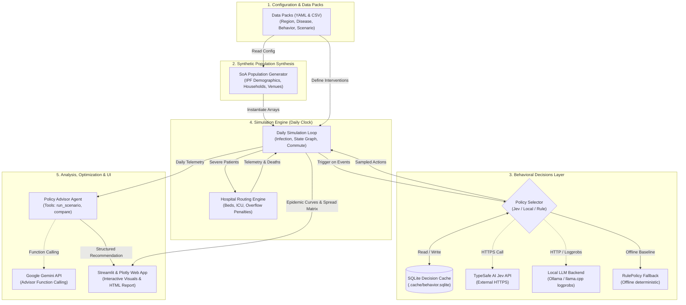

# EpiSwarm Studio: Architecture & Data Flow

This document visualizes the complete end-to-end data flow of EpiSwarm Studio, mapping input files, synthetic population synthesis, behavioral decisions, simulation execution, and external integrations.

---

## High-Level System Architecture

---

## Key Node Descriptions

1. **Data Packs (Files)**: User-provided CSV and YAML configurations specifying administrative areas, population marginals, disease transition rates, and intervention policies.
2. **SoA Population Generator**: Converts statistical marginals into contiguous Structure-of-Arrays NumPy memory blocks (`agent_id`, `age`, `household_id`, `workplace_id`, `compliance`).
3. **Daily Simulation Loop**: Vectorized transmission engine evaluating contact layers (household, school, workplace, community) using `numpy.bincount`.
4. **Policy Selector**: Routes behavioral prompts to TypeSafe AI Jev (if configured), local LLM logprob engine (if running), or RulePolicy fallback.
5. **SQLite Decision Cache**: Prevents duplicate LLM queries by memoizing probabilities keyed by `(bucket_hash, situation_hash, question_id)`.
6. **Hospital Routing Engine**: Allocates patients to nearest available hospital beds across administrative areas and calculates overflow mortality penalties.
7. **Policy Advisor Agent**: Employs function calling (via Google Gemini) to iterate through candidate measures and generate Pydantic `Recommendation` objects.
8. **Streamlit & Plotly Web App**: User-facing interactive dashboard for visualizing counterfactual trajectories, spatial spread matrices, and demographic equity audits.
