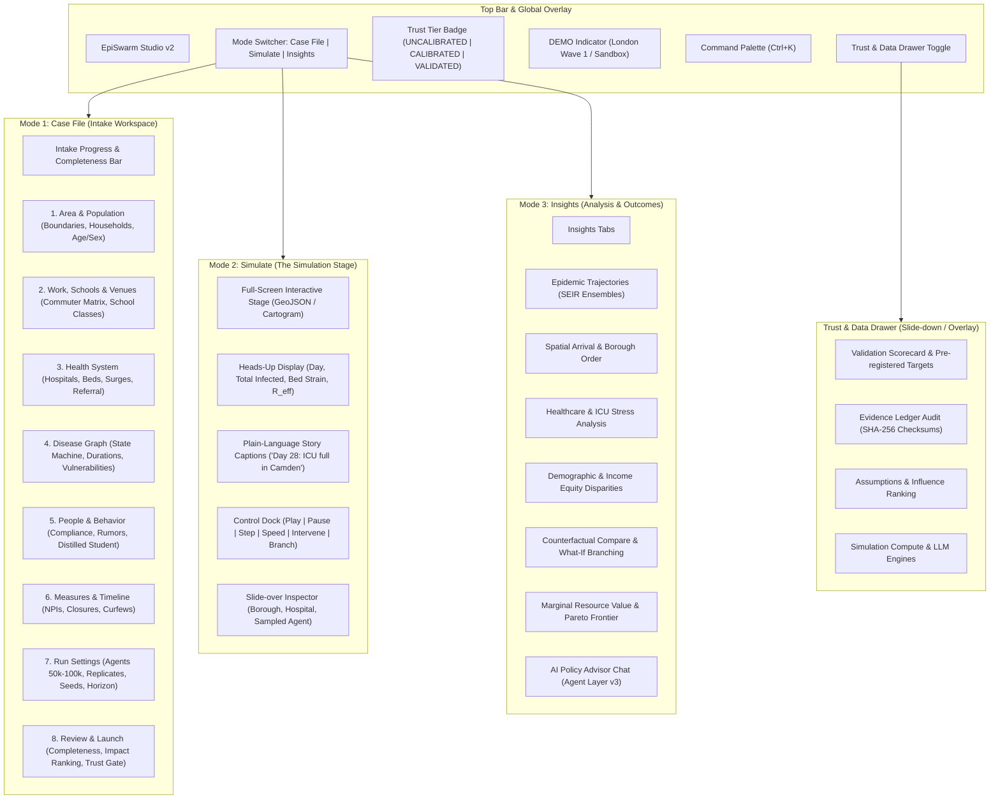

# EpiSwarm Studio v2: Information Architecture

## 1. Architectural Philosophy
EpiSwarm Studio v2 replaces the legacy 17-item persistent left sidebar with a focused, high-authority **canvas-first** architecture tailored for government health authorities and scientific teams:
- **No permanent sidebar**: The canvas occupies 100% of the viewport width.
- **Three Core Modes**:
  1. **Case File**: Full intake workspace where officials configure and audit their city/region case file.
  2. **Simulate**: The live, interactive Simulation Stage canvas with real-time spread animation, commuter fluxes, and playback dock.
  3. **Insights**: In-depth analytical suite synthesizing epidemiological curves, bed capacity, equity, Pareto frontiers, and advisor chat.
- **Top Utility Drawer**: **Trust & Data**, accessible globally to inspect validation scorecards, cryptographic evidence ledgers, and engine backends without leaving the active mode.
- **Global Command Palette (`Ctrl+K`)**: Rapid keyboard-driven navigation across any parameter, borough, hospital, or scenario.

---

## 2. Information Architecture Diagram

---

## 3. Screen Inventory & Component Mapping

| Screen / Component | Mode / Area | Legacy Studio Equivalent | Key Upgrades |
|---|---|---|---|
| **Case File Overview** | Case File | `/regions`, `/diseases`, `/scenarios` | Single unified versioned Case File container with audit logs, duplication, and export. |
| **Intake Sections 1–8** | Case File | `/builder`, `/quick` | Guided step-by-step intake forms, CSV/Excel column mappers, downloadable templates, and "Estimate for Me" AI assistant. |
| **Simulation Stage** | Simulate | `/spatial` (was static 357-line SVG) | Full-screen live canvas, animated commuter figures (labeled illustrative), hospital strain meters, real-time story feed. |
| **Control Dock & HUD** | Simulate | `/runs` form | In-run interactive controls: play, pause, step-1, speed (1x-10x), instant intervention injection, and checkpoint branching. |
| **Insights Hub** | Insights | `/results`, `/capacity`, `/equity`, `/compare`, `/optimization`, `/advisor` | Unified multi-tabbed analytical suite with ensemble confidence bands, Pareto curves, and spatial rankings. |
| **Trust & Data Drawer** | Global Drawer | `/validation`, `/evidence`, `/settings` | Global slide-down drawer exposing SHA-256 provenance hashes, validation gates, and backend status without leaving the run. |

